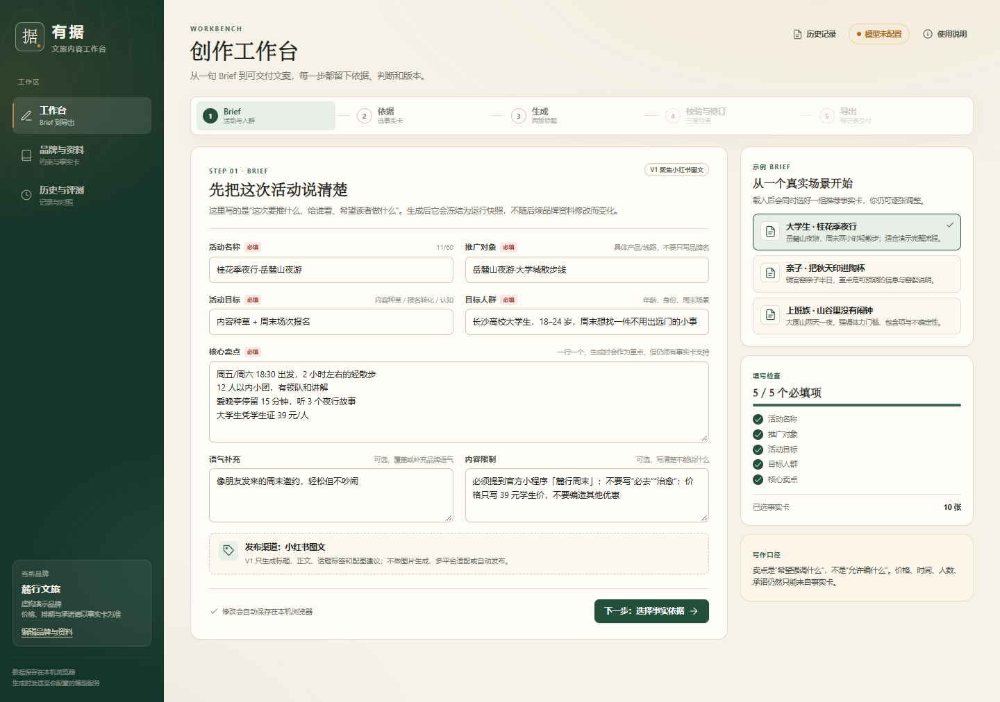
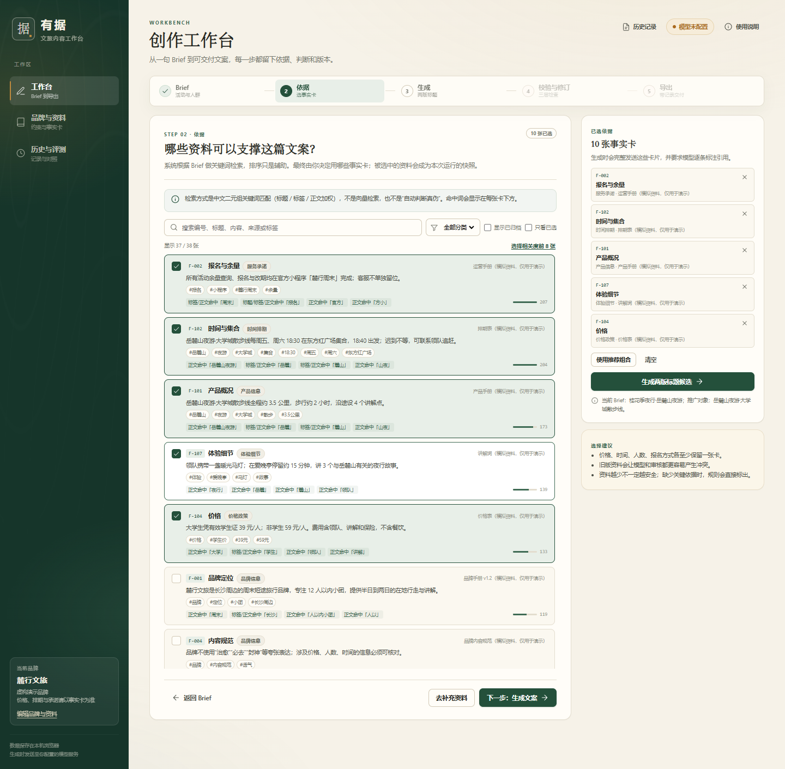
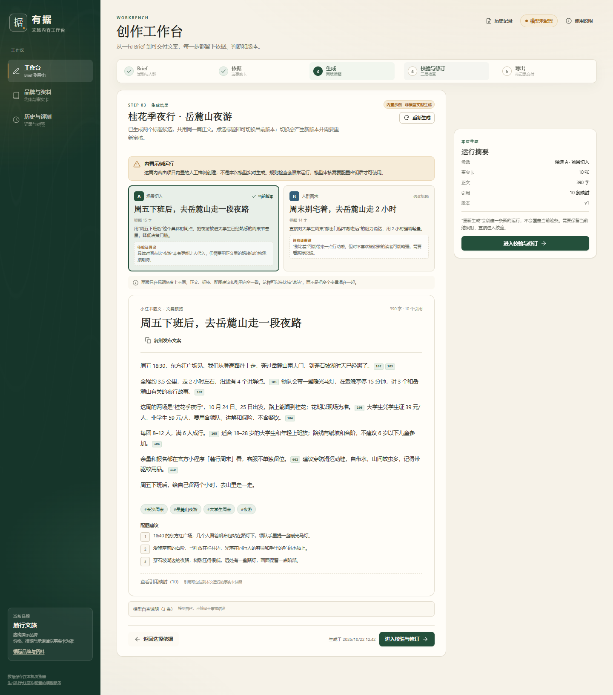
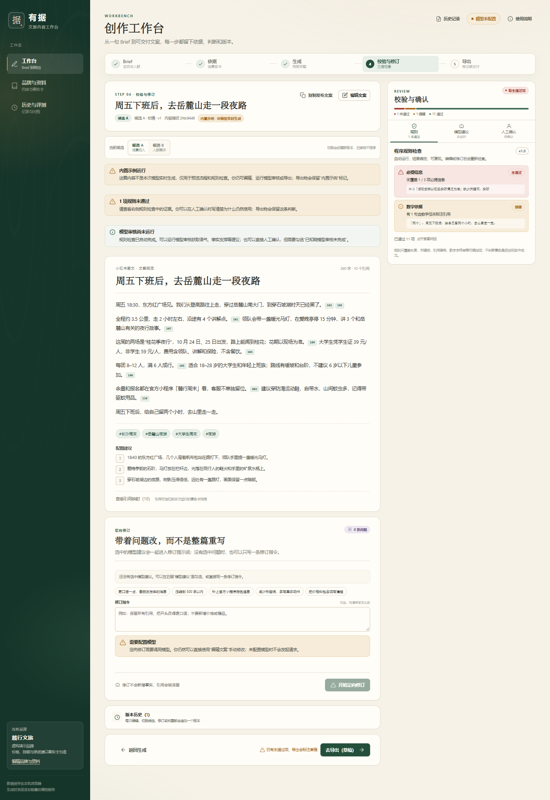
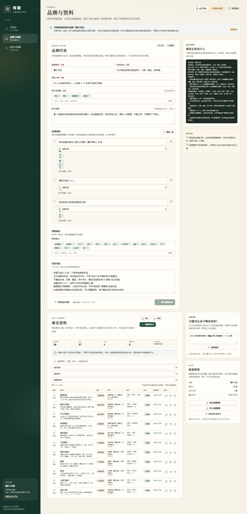
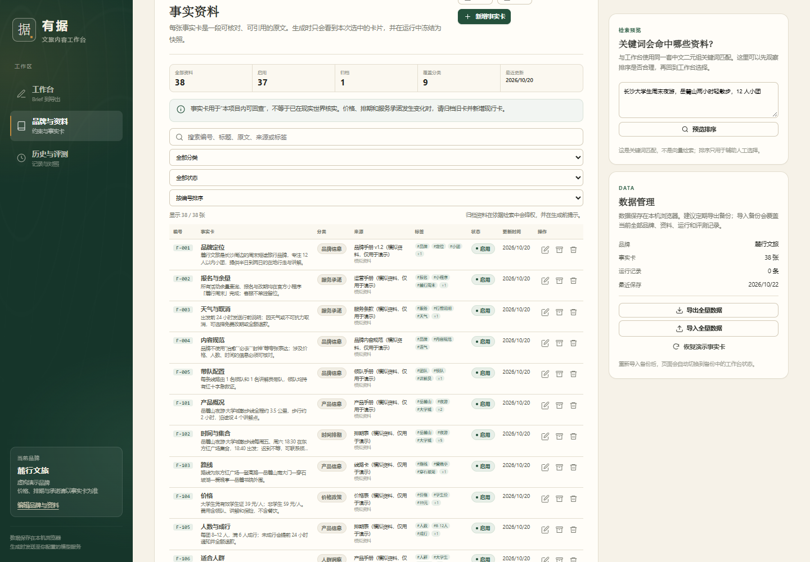
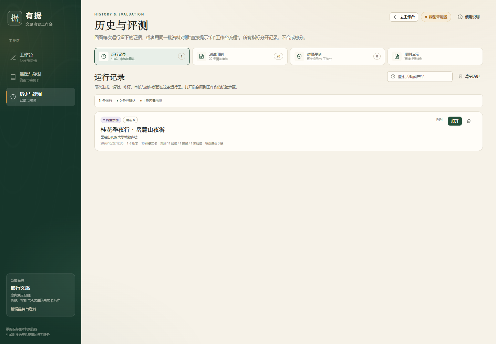
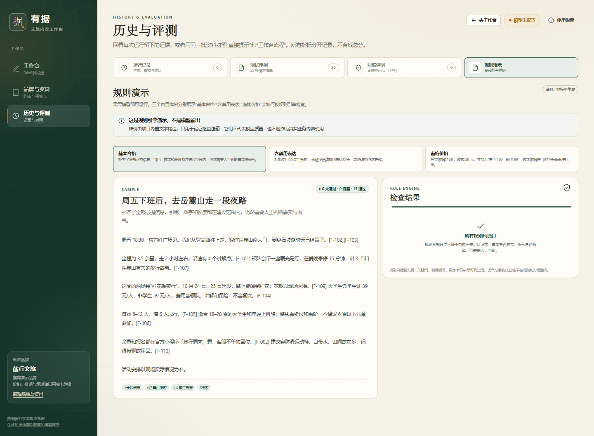

# 有据 · 文旅营销素材生成与校验工作台

这是我为 AI Builder / AI 产品岗位准备的一个个人 demo。

我想做的不是“再包一个文案生成器”，而是把文旅营销内容的生产过程拆开：品牌要求是什么、这次活动要推什么、哪些资料能当依据、生成后怎么查、改完谁来确认。最后把这些步骤串成一个能本地跑起来的工作台。

- 文案里的事实性信息，尽量能回查到事实卡原文；
- 规则检查、模型建议、人工确认分开，不混成一个“AI 说没问题”；
- 改完会生成新版本，旧的审核和确认自动失效；
- 导出的不只是文案，还有引用、检查记录和修改过程；
- 没有模型密钥时，也能用内置示例把界面和规则跑一遍。

> 这个版本只做小红书图文：标题、正文、话题标签、配图建议。图片/视频生成、多平台、自动发布、账号和数据库都还没做。

---

## 界面

### 创作工作台

| Brief | 选择事实依据 |
| --- | --- |
|  |  |

| 生成结果 | 校验与修订 |
| --- | --- |
|  |  |

### 品牌与资料

| 品牌约束与提示词预览 | 事实资料库 |
| --- | --- |
|  |  |

### 历史与评测

| 运行记录 | 规则演示 |
| --- | --- |
|  |  |

> 截图里的「麓行文旅」是我编的演示品牌，价格、排期、用户反馈都是模拟数据。`docs/screenshots/mock/` 里是本地 Mock 的联调截图，只用来证明接口和页面能跑通，不代表模型写得好不好。

---

## 我为什么做这个

文旅营销内容有几个很现实的约束：

1. 周末活动、节点促销，内容要出得快；
2. 价格、时间、人数、报名方式、服务承诺，不能写错；
3. 品牌有固定的必提信息、禁用表达和语气要求，换个人写就容易漂。

通用模型能解决“快”，但我自己用下来，最不放心的不是它写得不够漂亮，而是它写得太顺，顺到你不知道哪句话是资料里的、哪句话是它补的。

所以这个项目重点不在“生成”，而在“生成之后怎么判断能不能用”：

- 资料从哪来、能不能回查；
- 规则能不能稳定地拦住明显问题；
- 模型给的意见是不是有原文依据；
- 人改完之后，之前的审核还算不算数；
- 最后交付给审核人的，除了文案还有没有判断过程。

---

## 给谁用

主要面向文旅品牌、景区的新媒体运营、营销策划和内容审核。

一个很典型的使用场景是：周末活动要上新，需要给大学生、亲子家庭或上班族写一篇小红书笔记；品牌有必提信息、禁用表达和语气要求；发布前还要核对价格、时间、人数和报名方式。

我希望它解决的问题是：

- 不是“再多几个版本文案”，而是**能判断哪一版可以用**；
- 不是“模型说没问题”，而是**问题在哪、依据是什么、谁确认过**；
- 不是“生成完就结束”，而是**改完之后旧结论会自动失效**。

---

## 使用流程

整个流程我拆成五步：

1. **Brief**：写清楚活动名称、推广对象、活动目标、目标人群、核心卖点，另外可以补充语气和内容限制。必填项会校验，也准备了三个示例 Brief。
2. **依据**：根据 Brief 从事实库里找资料，展示命中了什么关键词、相关度多少。系统只做推荐，最后勾哪些由人决定。
3. **生成**：一次调用返回一篇共享正文和两个标题候选，一个从场景切入，一个从人群需求切入。正文、标签、配图建议保持一致，只比较标题说法。
4. **校验与修订**：规则检查自动跑；模型审核需要手动点；有问题可以勾选后做定向修订；修订完看句级 diff；最后人工确认。
5. **导出**：可以导出 Markdown 或 JSON。发布用的文案会自动去掉引用标记，完整记录会保留引用、规则、模型建议、确认和修订历史。

### 三层校验

| 层 | 检查什么 | 谁来判断 |
| --- | --- | --- |
| 程序规则 | 标题/正文长度、标签数量、必提关键词、禁用表达、绝对化表达、引用编号、引用数量、引用原文、数字依据、标题差异、标点、配图建议、归档资料 | 代码，结果可复现 |
| 模型建议 | 品牌语气、人群匹配、事实支撑、结构表达、合规风险 | 模型给线索，人判断 |
| 人工确认 | 事实是否准确、语气是否合适、信息是否完整、是否适合发布 | 当前操作者，绑定版本和内容指纹 |

数字依据这块我做得比较细：模型经常把 `[F-xxx]` 写在句号后面，规则会先把紧跟句末标点的引用归到前一句/段落，再看数字能不能在引用资料里找到。它只做字符串级定位，不判断语义上是否真的成立。

引用也是一样：

- “引用可定位”只说明能在这次运行的事实卡快照里回查；
- 不代表事实已经在现实世界里核实过；
- 如果模型给的原文片段在文案里找不到，服务端会把片段清空并标成低置信度，不会直接当真。

---

## 几个我在意的取舍

- **两个标题共用正文**：先比较“说法”，不要把标题、正文、标签几个变量混在一起。只叫候选，不叫 A/B 测试。
- **版本链而不是覆盖保存**：编辑、切换候选、定向修订、恢复旧版本都会追加一个新版本，每个版本有内容指纹。
- **审核和确认绑定版本**：审核记录按 `versionId + contentHash` 找；内容一改，旧审核和旧确认自然失效。
- **生成时冻结快照**：Brief、品牌、事实卡在生成时存一份，后面改品牌资料不会把历史运行改掉。
- **人工判断要留痕**：规则没过也能确认，但要写清楚为什么；模型审核没跑，确认时要勾“已知晓”。
- **本地优先**：品牌、资料、运行和评测都放在浏览器 localStorage；模型密钥只在服务端读。
- **边界写清楚**：关键词检索就是关键词检索，不是向量检索；规则不是事实核查；模型建议不是平台审核；Mock 也不代表模型质量。

---

## 功能

### 工作台

- 五步流程、步骤校验、自动保存、移动端单列。
- 三个示例 Brief，带推荐事实组合。
- 关键词检索：中文二元组 + IDF + 分类相关性，显示命中原因和分数。
- 两个标题候选，共享正文；显示模型、耗时和 token。
- 规则检查自动运行，失败/提醒/通过分组展示，附证据。
- 模型审核、问题勾选、定向修订、句级 diff、变更说明、未解决问题。
- 人工确认清单、备注、规则未通过 override、模型未完成知晓。
- 版本历史、恢复为新版本、内容指纹。
- 复制发布文案（自动去引用）、完整 Markdown/JSON 导出。

### 品牌与资料

- 品牌名称、定位、人群、语气关键词、语气说明、必提信息、禁用表达、写作约束。
- 提示词预览：看看模型实际会收到什么约束。
- 事实卡新增、编辑、归档、删除、搜索、筛选、排序。
- 导入 JSON 或 Markdown/纯文本，先解析预览，再确认导入。
- 事实资料导出、全量数据导入/导出、恢复演示资料。
- 检索预览：拿一段话试试关键词排序是否合理。

### 历史与评测

- 运行记录：状态、版本数、事实卡数、规则统计、模型建议数，可打开、删除、清空。
- 20 条测试用例：正常生成、受众差异、必填缺失、资料不足、资料冲突、诱导编造、必提/禁用、引用缺失、人工编辑后重检、API 异常。
- 对照评测：同一个 Brief、同一批事实、同一个模型，对比“直接提示”和“完整工作台流程”；指标分开记，支持人工 1–5 分；可以单条跑，也可以批量跑。
- 规则演示：三个离线样例，不调用模型，专门看规则引擎怎么拦问题。

---

## 技术实现

```text
Next.js 16 App Router + React 19 + TypeScript + 普通 CSS
├─ src/app/                    页面和 API
├─ src/components/             工作台 / 资料 / 历史 / 通用 UI
├─ src/state/                  localStorage、reducer、selectors
├─ src/lib/domain/             类型、运行/版本工厂、导入解析
├─ src/lib/review/             规则、引用、数字、内容指纹
├─ src/lib/retrieval/          中文二元组、IDF、排序
├─ src/lib/prompts/            生成/审核/修订/直出提示词
├─ src/lib/llm/                OpenAI-compatible 客户端、JSON 解析
├─ src/lib/evaluation/         对照评测指标与运行器
├─ tests/unit/                 44 个 Vitest 单元测试
└─ scripts/                    Mock LLM、E2E、截图脚本
```

### 接口

| 路由 | 作用 |
| --- | --- |
| `POST /api/generate` | Brief + 品牌 + 事实 → 共享正文、两个标题、标签、配图建议、引用、模型信息 |
| `POST /api/review` | 当前版本 + 上下文 → 模型问题列表 |
| `POST /api/revise` | 当前版本 + 选中问题 + 指令 → 修订版本、变更说明、保留引用 |
| `POST /api/generate-direct` | 对照基线：同一批资料，单次普通提示，四段纯文本 |
| `GET /api/health` | 有没有配置、模型名、服务地址、超时；不返回 key |

- 所有接口都在服务端跑，每次请求都带 Brief/品牌/事实快照，不依赖服务端状态。
- 用原生 `fetch` 调 OpenAI-compatible Chat Completions，不绑某一家 SDK。
- 密钥只从 `LLM_API_KEY` 读，不会出现在浏览器代码、localStorage 或仓库里。
- 错误码统一：`MISSING_API_KEY`、`LLM_UNAUTHORIZED`、`LLM_RATE_LIMITED`、`LLM_TIMEOUT`、`LLM_UPSTREAM_ERROR`、`LLM_FORMAT_ERROR`、`LLM_SCHEMA_ERROR`、`BAD_REQUEST`。
- 失败时保留输入，给出可操作的建议和重试按钮；不会拿示例结果冒充实时生成。

### 数据

- 一个 key `youju.state.v1`：`brand / facts / runs / evaluations / workbench / settings`。
- 存储带版本、损坏恢复、配额提示、JSON 导入导出。
- 运行保存 Brief/品牌/事实快照；改事实卡不会影响历史运行。
- 页面挂载后再读 localStorage，避免 SSR 水合问题。

---

## 快速开始

需要 Node.js >= 20.9 和 npm。

```bash
npm install
cp .env.example .env.local   # Windows 直接复制这个文件也行
# 在 .env.local 里填 LLM_BASE_URL / LLM_API_KEY / LLM_MODEL
npm run dev
```

打开 http://localhost:3000 。

### 没有 key 怎么看？

1. 打开工作台；
2. 走到“生成”这一步；
3. 点 **加载内置示例运行**。

这样能看到生成结果、规则检查、人工确认、导出和一部分评测界面。内置示例会一直标着“非模型实时生成”，不会伪装成实时结果。

### 本地 Mock

```bash
npm run mock
```

另开一个终端，在 `.env.local` 里写：

```bash
LLM_BASE_URL=http://127.0.0.1:8787/v1
LLM_API_KEY=mock-key
LLM_MODEL=mock-model
LLM_TIMEOUT_MS=60000
```

Mock 支持正常、401、429、500、超时、非法 JSON 等模式。可以把模式写进 `tmp/mock-mode`（`401` / `429` / `500` / `invalid` / `timeout` / `slow`），具体看 `scripts/mock-llm.mjs` 顶部注释。**Mock 只是用来联调，不能拿来证明模型效果。**

### 测试和构建

```bash
npm test        # 44 个单元测试
npm run build   # 生产构建
npm run start   # 生产启动
```

---

## 模型配置

```bash
LLM_BASE_URL=https://api.deepseek.com/v1
LLM_API_KEY=sk-...
LLM_MODEL=deepseek-chat
LLM_TIMEOUT_MS=60000
```

只要服务兼容 OpenAI Chat Completions 就能接：

- `POST {LLM_BASE_URL}/chat/completions`
- `Authorization: Bearer ...`
- `choices[0].message.content` 返回文本
- 模型 JSON 输出比较稳定（项目里会做提取和 schema 校验）

几个常见服务商示例，实施前最好再核对一下官方文档和模型名：

| 服务 | Base URL 示例 | 模型名示例 |
| --- | --- | --- |
| DeepSeek | `https://api.deepseek.com/v1` | `deepseek-flash` |
| 阿里云百炼 / DashScope 兼容模式 | `https://dashscope.aliyuncs.com/compatible-mode/v1` | `qwen-plus` |
| Moonshot | `https://api.moonshot.cn/v1` | `moonshot-v1-8k` |
| OpenAI | `https://api.openai.com/v1` | `gpt-4.1-mini` |

> 不要把真实密钥写进代码、截图、README 或 `.env.example`。`.env.local` 已经在 `.gitignore` 里。

---

## 怎么用

1. **Brief**：可以载入“大学生夜游 / 亲子陶艺 / 上班族徒步”示例，也可以自己填。
2. **依据**：系统按关键词推荐，最后勾哪些由你定。旧版/归档资料会有提示。
3. **生成**：配置模型后点生成，得到两个标题候选和同一篇正文。选标题会切换当前版本。
4. **校验与修订**：
   - 先看规则检查的未通过项和提醒；
   - 需要模型意见时点“运行审核”；
   - 勾选问题、写修订指令，生成修订版本；
   - 在“人工确认”里逐项核对、写备注；规则没过时要写 override 理由。
5. **导出**：
   - “复制发布文案”会自动去掉 `[F-xxx]`；
   - “下载 .md / .json”会保留完整引用、规则、模型建议、确认和修订记录；
   - 没确认的导出物会标“草稿（未经人工确认）”。

### 数据管理

- 数据存在本机浏览器，不上传到这个项目的服务器。
- 生成/审核/修订时，相关 Brief、品牌、事实卡和文案会发给你配置的模型服务商；别放敏感资料。
- 在“品牌与资料 → 数据管理”可以导出/导入全量数据、恢复演示资料。
- 本地存储坏掉时，页面会提示并加载初始示例；原始内容还在浏览器存储里，可以先导出排查。

---

## 测试和验证

### 单元测试

`npm test` 覆盖了：

- 规则边界：必提关键词、禁用表达、虚构价格、未知引用、句末引用归属、段落级引用上下文；
- 检索：中文二元组、IDF 排序、归档降权、搜索；
- 版本工厂：编辑/切换候选/恢复、审核失效、确认失效、模型问题状态；
- reducer：运行聚焦、删除事实不影响快照、清空历史/全量数据；
- 导出：草稿/定稿、引用脚注、发布文案去引用、JSON schema；
- LLM：缺 key、JSON 提取、生成/审核/修订 schema、无法定位的模型引用；
- 评测指标：引用有效率、无依据数字、结构完整；
- 事实卡导入：JSON、文本模板、非法分类。

当前是 **9 个测试文件、44 个测试，全部通过**。

### 本地 Mock E2E

```bash
npm run mock
# 另开终端，.env.local 指向 127.0.0.1:8787/v1
node scripts/e2e-mock.mjs
node scripts/e2e-comparison.mjs
```

跑过一遍完整链路：Brief → 检索 → 生成 → 选候选 → 模型审核 → 定向修订 → 人工确认 → 导出；也测了对照评测的单条运行和人工评分保存。

### 错误处理

| 场景 | 结果 |
| --- | --- |
| 401 / 错误密钥 | `LLM_UNAUTHORIZED`，HTTP 502，输入保留 |
| 429 限流 | `LLM_RATE_LIMITED`，HTTP 429 |
| 500 上游错误 | `LLM_UPSTREAM_ERROR`，HTTP 502 |
| 超时 | `LLM_TIMEOUT`，HTTP 504 |
| 非 JSON 返回 | `LLM_FORMAT_ERROR`，HTTP 502，附原始输出片段 |
| 缺少 API key | `MISSING_API_KEY`，提示配置 `.env.local` 或加载内置示例 |

---

## 评测

> 详细协议、20 条用例和结果模板在 [`docs/EVALUATION.md`](docs/EVALUATION.md)。

- **20 条测试用例**：正常生成 4、受众差异 2、必填缺失 2、资料不足 2、资料冲突 1、诱导编造 3、必提/禁用 2、引用缺失 1、人工编辑后重检 1、API 异常 2。
- **10 组对照**：同一个 Brief、品牌、事实、模型和参数；直接提示也拿到完整资料，不故意写弱。
- **指标分开记**，不合成总分：
  - 结构完整率；
  - 规则通过数 / 总数；
  - 引用有效率（直出一般是 N/A）；
  - 无依据数字数量；
  - 人工事实支持 1–5；
  - 人工品牌适配 1–5；
  - 实际耗时。
- 样本很小，只有单模型、单评分者、单次运行，我不把它当成统计结论。
- Mock 结果只放在工程联调里，不当模型质量证据。
- 真实模型的评测我还没有跑。配置 key 后可以在“历史与评测 → 对照评测”里逐条或批量跑，结果会标实时/Mock。

---

## 关于作者

我是这个项目的作者，GitHub 上是 `lingzhou592`。

这个项目里，我主要负责：

- 选题和范围收敛，决定第一版只做小红书图文；
- 用户和任务拆解，把流程拆成五步；
- 三层校验的规则分类、引用口径和人工确认机制；
- 生成/审核/修订的提示词和 JSON schema；
- 20 条测试用例和 10 组对照评测的设计；
- 验收、测试、文档和演示脚本。

代码实现用了 AI 辅助，我负责逐项验收、改错、补测试和整理文档。

和之前工作的关系：

- 做过文旅资源管理、POI/空间查询和 AI 讲解相关的产品工作 → 这个项目的文旅场景、事实卡和“可核对”的交互；
- 做过知识图谱 + RAG 问答的产品工作 → 引用/依据、可追溯输出和边界说明；
- 做过校园宣传、活动摄影和内容制作 → 内容审核、品牌口径、发布前检查。

---

## 这个版本的局限

- 只做小红书图文，没有图片/视频、多平台、自动发布和真实投放；
- 数据在浏览器 localStorage，没有账号、数据库、团队协作和权限；
- 检索是中文关键词 + IDF + 分类相关性，不是向量检索；
- 规则只做字符串级检查，不能判断事实在现实里是否成立；
- 模型建议可能漏判/误判，置信度是模型自评，没有校准；
- 评测是单模型、单评分者、单次运行；
- Mock 只能证明接口能跑通，不能证明模型效果；
- 目前是本地跑的个人项目，公开部署前还要补鉴权、限流、审计和数据隔离。

---

## 后面想继续做的

1. **检索**：在保留引用可追溯的前提下，试试向量/混合检索，但仍然把命中依据显示出来；
2. **多平台**：小红书之外的渠道适配和长度/格式规则；
3. **团队流程**：账号、数据库、审核角色、评论和审批流；
4. **评测**：多评分者、重复运行、置信区间；接真实模型后把参数和原始输出都记下来；
5. **素材**：从配图建议扩展到图片生成/素材库，但素材来源还是要能回查；
6. **发布**：在明确授权和平台合规的前提下，再考虑接发布和回流数据。

---

## 目录

```text
.
├─ src/app/                    页面和 API
├─ src/components/             工作台 / 资料 / 历史 / 通用 UI
├─ src/state/                  持久化、reducer、selectors
├─ src/lib/                    领域、检索、规则、提示词、LLM、评测、导出
├─ tests/unit/                 44 个单元测试
├─ scripts/                    Mock LLM、E2E、截图
├─ docs/
│  ├─ PRODUCT.md               产品终案（没有方案比较）
│  ├─ EVALUATION.md            测试与评测协议
│  ├─ DEMO-SCRIPT.md           2–3 分钟演示口播稿
│  └─ screenshots/             界面截图（mock/ 是本地 Mock 联调）
├─ .env.example
├─ README.md
└─ LICENSE
```

---

## 数据和隐私

- 品牌、事实卡、运行、评测都存在本机浏览器 localStorage。
- 调模型时，Brief、品牌约束、所选事实卡和当前文案会发给你配置的模型服务商。
- `LLM_API_KEY` 只在服务端读，不会进浏览器 bundle、localStorage 或 Git。
- 不要把真实客户资料、未公开价格、个人信息或密钥提交到公开仓库。
- 这个仓库里没有简历 docx 或提取文本，`.gitignore` 也排除了 `*.docx` 和本地环境文件。
- 现在是本地 demo，公开部署前要补鉴权、限流、审计和数据隔离。

---

## 常见问题

**没有 API key 能做什么？**

可以完整看 Brief、依据、内置示例、规则检查、人工确认、导出、历史、测试用例和规则演示；不能实时生成、审核、修订。

**为什么示例运行标着“非模型实时生成”？**

因为它是用来预览界面和规则引擎的，不是这次模型调用的结果。跑模型审核或重新生成之后，才会有真实的模型调用记录。

**为什么规则说“数字没有依据”，但我写了引用？**

规则会看数字能不能在引用的那几张事实卡里找到，而且引用标记要在同一句或同一段落内。模型常把 `[F-xxx]` 写在句号后面，系统会先把紧跟标点的引用归到前一句/段落；如果还是失败，就检查一下引用编号和事实卡原文。

**为什么模型审核是可选的？**

规则检查和人工确认在没有模型时也能工作，模型审核是额外线索。没跑模型审核时，人工确认要勾“已知晓模型审核未完成”，导出物也会保留这个状态。

**改了文案，为什么之前的审核/确认没了？**

因为修改会创建新版本；审核和确认绑定 `versionId + contentHash`，旧记录还在历史里，但不再对当前版本生效。

**数据存在哪？怎么备份？**

浏览器 localStorage。到“品牌与资料 → 数据管理”导出全量 JSON；导入会覆盖当前数据。

**可以用自己的品牌资料吗？**

可以，替换品牌约束和事实卡就行。用之前确认一下资料你有权使用，也别把敏感内容提交到公开仓库。

---

## License

MIT。见 [`LICENSE`](LICENSE)。

演示品牌“麓行文旅”和全部价格、排期、服务承诺都是虚构内容，只用于产品演示。
